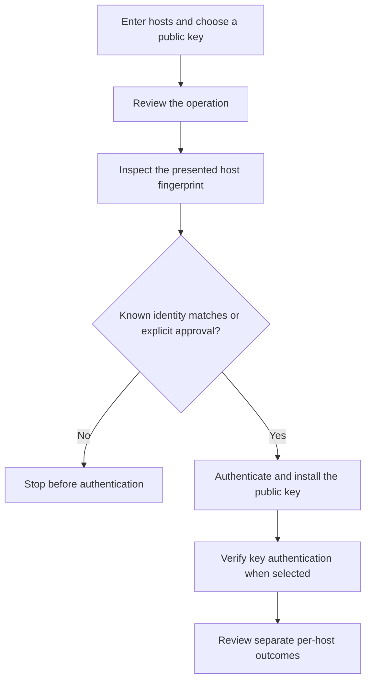

# WinSshCopyId

A native Windows x64 workspace for installing an SSH **public** key on one or
more hosts, reviewing host identity, and retaining separate installation and
verification outcomes.

[Documentation and wiki](https://ding-ding-projects.github.io/WinSshCopyId/) ·
[Public screenshot gallery](https://ding-ding-projects.github.io/WinSshCopyId-evidence/) ·
[Roadmap](ROADMAP.md) · [Implementation handoff](HANDOFF.md)

**Conversion in progress.** The native workspace and service foundations are
integrated. The complete requested feature inventory, installed-package acceptance
and update workflow remain unfinished. The screenshot gallery is being published
as a separate evidence record; each capture identifies its actual source and limits.

<details open>
<summary>Current behavior and evidence</summary>

- Native Connections, Keys, Results, Tools, History, Settings and Help destinations.
  Advanced tool and workspace capabilities remain explicitly incomplete.
- Explicit first-contact fingerprint approval before authentication. Changed known
  identities stop authentication.
- Public-key selection/generation, duplicate avoidance, batch continuation and
  separate installation/verification results. Cancellation does not claim to undo
  an already completed server change.
- Portable profiles omit credentials. Imported key paths remain opaque until
  explicit key selection, and importing clears the live password.
- Remembered credentials use Windows Credential Manager, with a transactional
  migration route for the earlier current-user DPAPI representation.
- Source-bound native captures at `817e9a5` cover English dark and bilingual light
  states at actual 150% scale, including 1200×800 and 640×480 logical layouts.
  They do not prove later source changes or other display scales.
- The integrated native build at `6a60fe0` passed through the root entrypoint,
  with 35 core tests and 11 UI-logic checks.
- Nine real loopback SSH checks cover trust and generated-key authentication,
  cancellation, timeout and partial outcomes. The fixture emulates commands;
  POSIX/OpenSSH server interoperability remains unverified.
- Seven managed converter fixtures passed actual AppContainer execution.
  External engines and complete GUI integration remain unfinished.

Info-icon guidance is preserved separately: native source `4ef11a2` covers
23 primary controls with 61 behavioral checks but no native runtime verification;
documentation source `71a855d` has 14 local checks and focused browser evidence.
Complete contextual wizard and playground coverage remains partial.

</details>

<details>
<summary>Build and packaging</summary>

Run the exact root entrypoints from a Windows checkout:

```bat
download-dependencies.bat /s
build.bat /s
build-installer.bat /s
build.bat --site /s
```

The pinned manifest selects .NET SDK 8.0.426 and verified portable tooling.
The x64 payload is self-contained. Packaging produces genuine unsigned
Squirrel.Windows assets. The inaugural installation directory is
`%LocalAppData%\WinSshCopyId.Desktop`; persistent application data remains
`%LocalAppData%\WinSshCopyId`.

Hosted workflows use standard `windows-2022` runners and run no tests or lint.
Publication, downloadable-byte verification and installed behavior have separate
verdicts. No successful release or installation is claimed by this README.

</details>

<details>
<summary>SSH workflow and privacy</summary>



Only public keys are sent to target hosts. Profile exports omit credentials.
Passwords, private mappings and private keys do not belong in logs, screenshots,
ordinary history or public records. The isolated evidence profile disables SSH
and real credential storage. Verify new host fingerprints through an independent
trusted channel before approving them.

</details>

## License

[MIT](LICENSE), copyright 2026 cafepromenade.
